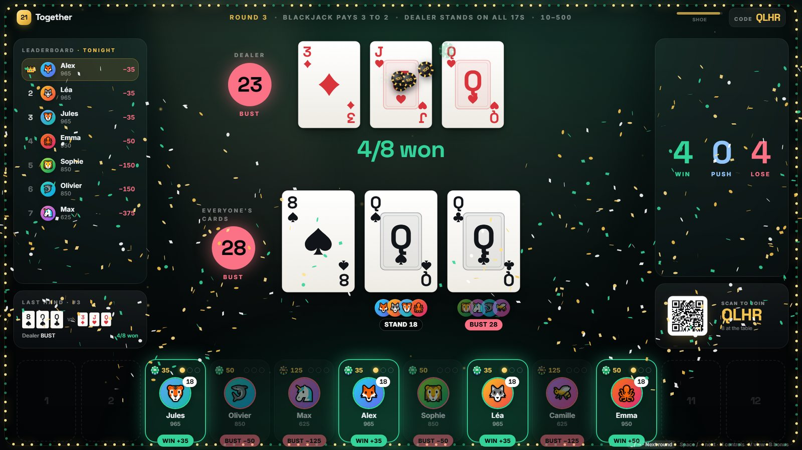
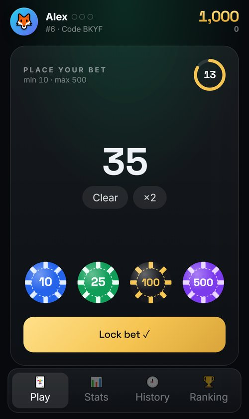
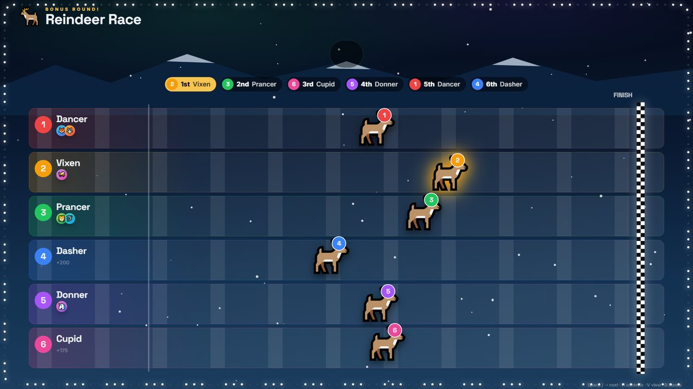

# 21Together

Shared-hand multiplayer blackjack for parties. One table on the TV, everyone plays from their phone.
Everyone gets **the same cards**, and each player decides on their own to **hit, stand or double**.

<p align="center">
  
</p>
<p align="center">
  
  &nbsp;
  
</p>
<p align="center"><em>The TV (top), a guest's phone (left) and the Reindeer Race bonus round (right).</em></p>

## Host your own copy (about 10 minutes)

> **Using Claude Code?** Open this folder in Claude Code and say:
> *"Read the README and deploy 21Together to my Cloudflare account."*
> Claude will follow the steps below. You only need to log in to Cloudflare in the browser when asked.

**You need:** a free [Cloudflare account](https://dash.cloudflare.com/sign-up), [Node.js](https://nodejs.org) 22 or newer, and git. The free plan is enough: no database or paid service required.

```bash
# 1. Get the code and install
git clone <repo-url> 21together
cd 21together
npm install

# 2. Log in to Cloudflare (opens the browser)
npx wrangler login

# 3. Deploy the game server, then the website
npm run deploy:worker
npm run deploy:web
```

That's it. The deploy prints two addresses:

- Website: `https://21together.<your-subdomain>.workers.dev`  ← open this on the TV
- Game server: `https://21together-api.<your-subdomain>.workers.dev`

The website finds the game server on its own (it adds `-api` to its name), so there is nothing to configure.
Check that it works: opening the game server address should show `{"ok":true,"service":"21together-api"}`.

**Notes for whoever (or whichever Claude) is deploying**

- **First Cloudflare deploy ever:** Wrangler may ask you to pick a `workers.dev` subdomain. Pick anything; it becomes part of the URL.
- **Keep the worker names** `21together` (web, `apps/web/wrangler.jsonc`) and `21together-api` (server, `apps/worker/wrangler.jsonc`). The website finds the server by that naming rule. If you rename them or use a custom domain, create `apps/web/.env.production` with `VITE_API_URL=https://<your-game-server-url>` and run `npm run deploy:web` again.
- **Deploy the worker first.** It contains the Durable Object (`GameRoom`, SQLite-backed, allowed on the free plan) that runs each table.
- **No database needed.** Games, chips, history and in-room stats live in the Durable Object. The optional Neon Postgres database only adds an all-time leaderboard across parties (see [Optional: all-time stats](#optional-all-time-stats-neon)). Skip it.
- **Free plan limits** (100k requests/day) are far above what a party uses: the game talks over WebSockets, which count very little.
- **Test before the party:** open the website on a laptop, click **Host a table**, then scan the QR code with two or three phones and play a round.
- **Updating later:** `git pull`, then run both deploy commands again.

## Party night checklist

1. Plug the laptop into the TV and open your website address (`https://21together.<your-subdomain>.workers.dev`) in Chrome.
2. Click **Host a table**. Press **F** for fullscreen and click once anywhere (this enables sound).
3. Guests scan the QR code on the TV (or type the 4-letter code), pick a name and an avatar, and tap **Take a seat**.
4. Press **Space** (or the **Start the game** button).
   - **Step by step** (press `M` or use the Auto / Step toggle): there are no countdowns, and you advance every beat with **Space** or **→**: *No more bets → Reveal → Flip the hole card → Dealer draws → Next round*. A presentation clicker works too (→ / PageDown). Dealing and card flips still animate on their own.
   - **Auto**: timers run the rounds by themselves (15 s to bet, 10 s per decision).
5. At the end, open **End the night** in the host bar to show the awards and podium.

**Host keyboard shortcuts** (on the TV laptop)

| Key | Action |
|---|---|
| `H` | show/hide host controls |
| `Space` | start · step mode: next beat · auto mode: pause / resume |
| `→` / `N` / `PageDown` | next beat (skips the timer in auto mode) |
| `M` | switch between Auto and Step by step |
| `V` | switch between the **Big screen** view (default) and the **Table** view |
| `B` | start a 🦌 **Reindeer Race** bonus (during betting, or right after the current payout) |
| `P` | players: top up chips (+500 / +1000), kick, ban |
| `S` | settings (decks, S17/H17, 3:2 vs 6:5, min/max bet, starting chips, seats, timers) |
| `F` | fullscreen |
| `Esc` | close a panel |

🦌 **Reindeer Race bonus:** when a player wins **3 hands in a row**, a bonus round unlocks (at most once every 6 rounds). Everyone picks a reindeer on their phone for free, and the long shots pay more. The player who unlocked it gets **×2**. You can turn it off in Settings or start one yourself with `B`.

Views:
- **Big screen** (default): a casino-style stadium display. Huge dealer and shared cards, a row of seats along the bottom, a live leaderboard, the bust risk, and HIT/STAND tallies. Call-outs like "No more bets!", "BUST ×4" and "Dealer busts!" appear, and the whole room celebrates together with a sunburst, confetti and crowd cheers. It stretches to fill ultrawide TVs.
- **Table**: the original top-down felt table with chairs around the arc.

Good to know:
- 12 seats max. Extra people wait "on the rail" and get the next free seat.
- If a phone locks or drops Wi-Fi, opening the page again puts the player back in the same seat with the same chips.
- If the TV page reloads, it stays the host: the host key is saved in that browser.
- Opening `/host/CODE` on a second screen shows a read-only spectator view.
- Players with no chips left: use **Players → Top up everyone broke**.

## How a round works

`Betting (15s) → deal 2 shared cards + dealer → decision steps (10s each) → dealer → payout`

In each decision step, every player who is still in chooses at the same time, and the choices stay hidden until the step ends.
If anyone hits, the **next shared card** is revealed and every hitter takes it. Players who stand stay where they are.
Doubling is allowed on the first decision only. Blackjack pays 3:2 and the dealer stands on soft 17 (both configurable).
Full spec: [docs/GAME_SPEC.md](docs/GAME_SPEC.md).

## Stack

| Part | Tech |
|---|---|
| `packages/engine` | Pure TS rules + room state machine (shoe, shared-hand rounds, payouts, achievements, awards) |
| `packages/protocol` | zod schemas for WebSocket messages |
| `apps/worker` | Cloudflare Worker + `GameRoom` Durable Object (WebSocket Hibernation, alarms for timers) |
| `apps/web` | React 19, Vite, Tailwind v4, Motion. Deployed as Cloudflare static assets (Pages on Workers) |
| Database (optional) | Neon Postgres: rounds, hands, all-time player stats across parties |

The deck lives only on the server, so phones never see upcoming cards.

## Development

```bash
npm install
npm test                       # engine unit tests (rules, room state machine, 100k-round sim, fuzz)
npm run dev:worker             # http://localhost:8787  (needs apps/worker/.dev.vars with DATABASE_URL, optional)
npm run dev:web                # http://localhost:5173  (phones on the same Wi-Fi can use http://<laptop-ip>:5173)

node scripts/bots.mjs http://localhost:8787 13 3     # 13 bots play 3 rounds (load test)
node scripts/e2e.mjs http://localhost:5173           # reconnect / kick / not-found checks
node scripts/shots.mjs http://localhost:5173 12 fr   # screenshots of every phase → screenshots/
node scripts/arena.mjs http://localhost:5173 8 en 2560   # big-screen step-mode walkthrough → screenshots/arena/
```

Deploy: see [Host your own copy](#host-your-own-copy-about-10-minutes).

### Optional: all-time stats (Neon)

Only needed if you want a leaderboard that survives across parties. Everything else works without it.

1. Create a free Postgres database at https://neon.tech and copy its connection string.
2. Apply the tables: put `DATABASE_URL="postgres://..."` in `apps/worker/.dev.vars`, then `cd apps/worker && npm run migrate`.
3. Give it to the deployed server: `cd apps/worker && npx wrangler secret put DATABASE_URL` (paste the same string).
